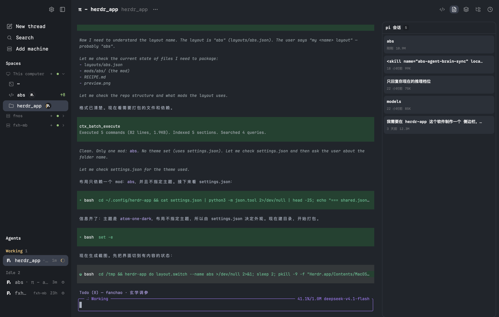

# abs

一个给 [Herdr](https://herdr.dev) 用的工作台：左边是空间和正在跑的 agent，中间是终端，右边是一块
记忆库面板，把项目里的 `.brain` 读成「会话 / 看板 / 图谱 / 日志」四页。整个窗口没有任何多余的边框和标题栏，
终端占满中间，右侧面板可收起。



## What you see

一行两列，没有任何标题栏（`titlebar: "none"`）：

**左侧栏，268px 宽，`chrome` 底色。**

从上到下三块：

- `side-top`，52px：右上角两个图标，齿轮（打开应用设置）和「收起侧栏」。
- `spaces-bar`，98px：竖排三个入口 —— New thread、Search、Add machine。
- 底下按高度平分两块（`weight: 1`，各最小 81px）：
  - `spaces`：工作区列表。按机器分组（本机在最上，远程机器各一个可折叠的组头）。
    每个工作区一行：图标 + 名字 + 运行中的 agent 圆圈 + git 分支和 ahead/behind。
  - `agents`：正在跑的 agent，按状态分区（Needs you / Working / Idle）。

**右侧工作区，占满剩余宽度，`canvas` 底色。**

- `head`，52px：左边是线程标题和项目名，一个 `···` 按钮开线程菜单；右边是打开菜单、
  TTT、四个页面图标（会话 / 看板 / 图谱 / 日志），当前页高亮。
- `work-body`，横向排列，内边距 `[8, 8]`，列间距 8：
  - 终端块，占满剩余宽度。pane 有 1px 边框、8px 圆角，聚焦时边框变绿（`ansi2`）。
  - 右侧面板，300px 宽（可拖 240–900），一张卡片。

**终端内边距** `[8, 6]`（上下 / 左右），字体和主题跟随人的 `settings.json`。

**右侧面板的四页**

- **会话**：当前目录的 pi 会话列表，每行标题、相对时间、大小。点一条在新 pane 里恢复它。
  悬停出现 `×`，点两次才删。
- **看板**：一张卡片，进行中的任务和已完成的任务直接排在一起，整张卡一起滚。
  每条是一块圆角卡片：最左边一个状态圆点（已完成是灰色），标题、描述、日期、子项树。
  翻页条钉在卡片底部，每页 20 条。
- **图谱**：铁律一张卡（默认露 3 条，可展开、可增删），图谱索引一张卡
  （`index.md` 里每个 `##` 分类一行，显示页数）。
- **日志**：`log.md` 的流水，按时间倒序，每条第一行当标题、剩下当详情，底部标作者和时间。每页 20 条。

底部一条 26px 的状态行：左边显示当前 `.brain` 路径（远程机器会带 `机器名:` 前缀），
右边两个图标直接用 Zed / VS Code 打开当前目录。

## How it behaves

**agent 状态**

工作区名字后面，每个正在跑的 agent 一个 18px 圆圈，圆里是它的图标（颜色取自 program 的
`tile`/`color`）。多个时叠着画，圆心距 10px，左边压住右边的，超过 4 个折成 `+N`。
状态按 `agents()` 的 `status`：

| status | 长什么样 |
|---|---|
| `working` | 沿圆圈边缘转一道橙色的弧（`spin(900)`），圆和图标不动 |
| `blocked` | 圆圈边框变蓝 |
| `done` | 圆圈边框变蓝 |
| `idle` | 只有图标，边框是普通的 `border` 色 |

状态靠每秒比对 `agents()` 拼成的串，只有真的变了才重绘，闲置时不空转。

**点击**

- 左侧空间行：单击切到那个空间；按住拖动可换顺序；右键开菜单（改名、颜色、关闭等）。
- 机器组头：单击折叠/展开这个机器的所有空间。
- 左侧 agent 行：单击跳到那个终端。
- 顶部四个页面图标：切页；已在这一页时再点收起右侧面板。
  **切页前会确保当前目录有 `.brain`，没有就在后台跑一次 `abs init`**（见 Watch out）。
- 终端的 Open 菜单：VS Code、Zed、TTT、文件窗口。远程空间里前三个会连到那台机器上。
- 右侧面板底部的两个图标：用 Zed / VS Code 打开当前目录。
- 看板里的任务卡：点开详情对话框，能看全文和子项。

**悬停**

- 空间行悬停时露出 `···` 菜单和「新线程」按钮，agent 圆圈在悬停时隐藏给它们让位。
- 会话行的 `×`、铁律的 `×` 都是悬停才出现。

**会动的**

- `working` 的 agent 圆圈边缘转弧
- 面板里的定时器：本机监听 `.brain` 目录变化，远程每 5 秒轮询一次

## Built from

### 布局 `layouts/abs.json`

根节点：

```json
{ "id": "root", "type": "row", "background": "canvas",
  "terminal_padding": [8, 6], "titlebar": "none", "traffic_lights": [12, 16] }
```

不设 `theme` / `font`，跟人的 `settings.json` 走。

树（括号里是 `size`）：

```
root (row)
├─ sidebar (column, px 268, min 39.6, max 432, background chrome, resizable false)
│  ├─ side-top        block → mod abs, props {part:"side-top"}      px 52, window_drag
│  ├─ spaces-bar      block → props {part:"spaces-bar"}             px 98
│  └─ sidebar-lists (column)
│     ├─ spaces       block → props {part:"spaces"}   weight 1, min 81
│     └─ agents       block → props {part:"agents"}   weight 1, min 81
└─ work (column, resizable false)
   ├─ head           block → props {part:"header"}                 px 52, window_drag
   └─ work-body (row, padding [8, 8], gap 8)
      ├─ thread (column, resizable false)
      │  └─ main  block → {tab:"active", pane:{border:{width:1,color:"border"},
      │                    focus:{width:1,color:"ansi2"}, radius:8, gap:8}}
      └─ review (column, px 300, min 240, max 900, background canvas)
         └─ review-body (stack, active "abs")
            └─ abs  block → mod abs, props {part:"panel"}
```

### 一个 mod：`mods/abs/`

`mod.json` 是 `{ "place": "none", "title": "abs" }` —— `place: none` 表示它不自动占位，
完全靠布局里的 `props.part` 选块。

`main.js` 是一张分发表，按 `props().part` 返回对应的 View：

| part | 文件 | 干什么 |
|---|---|---|
| `side-top` | `parts/side.js` | 齿轮 + 收起侧栏 |
| `spaces-bar` | `parts/spaces-bar.js` | New thread / Search / Add machine |
| `spaces` | `parts/spaces.js` | 工作区列表，分组、拖拽、agent 圆圈 |
| `agents` | `parts/agents.js` | 运行中的 agent，按优先级分区 |
| `header` | `parts/head.js` | 顶栏、四页按钮、打开菜单 |
| `panel` | `parts/panel.js` | 右侧记忆库面板，四页 |
| `open-menu` / `quick-open` / `menu` / `space-icon` | `head.js` / `menu.js` / `space-icon.js` | 各种弹层 |

`parts/lib.js` 是共用的小工具（图标、相对时间、`machineOf`、git diff 统计等），
`parts/side.js` 里还有标题推断（`threadTitle` / `projectName`）。

`scripts/scan.js` 是给远程机器用的扫描脚本：pi 把会话存在
`~/.pi/agent/sessions/<slug>/<时间>_<uuid>.jsonl`，首行就有 id / timestamp / cwd，
所以只流式读开头几百 KB 就能列出会话，不用把几 MB 读进来。本机直接跑它，
远程把源码 base64 传过去在那台机器上跑。

### 用到的 `herdr` 函数

`spaces` `panes` `agents` `machines` `focused` `layout` `run` `theme` `shared` `setShared`
`openOverlay` `closeOverlay` `props` `window` `nextCommand` `home` `appHome`
`readTextFile` `writeTextFile` `watchFolder` `exec` `hc` `notify` `pickFolder`
`localStorage`

### 跑的外部命令

- `sh -c 'exec printf %s "$HOME"'`（远程取家目录）
- `node scripts/scan.js --limit N`（列 pi 会话）
- `sh -c "cd <dir>; [ -d .brain ] || abs init"`（点四页按钮时补一次 `.brain`）
- `/Applications/Zed.app/Contents/MacOS/cli <dir>` 或 `ssh://<host><dir>`
- `/Applications/Visual Studio Code.app/Contents/Resources/app/bin/code <dir>` 或 `--remote ssh-remote+<host> <dir>`
- `open <dir>`（文件窗口）
- `hc machine ls`（查机器名对应的 ssh 地址）

### 素材

`icons/` 下 54 个 svg（来自 lucide 风格的单色线条图标），布局和按钮都用它们。
`ring-spin.svg` 是专门画的：18px 圆边缘上的一段弧，用来做 working 状态的转圈描边。

## Watch out

**这个布局依赖 `abs` 这套记忆库系统。** 不装它，右侧面板会一直显示「没找到 .brain 目录」。
安装见下方「先装 abs」。

**点四页按钮会跑 `abs init`。** 代码在 `head.js` 的 `ensureBrain()`：

```js
exec("sh", ["-c", `cd "${dir}" 2>/dev/null || exit 0; [ -d .brain ] || abs init >/dev/null 2>&1`], on ? { on } : undefined)
```

它只在 `.brain` 不存在时才跑，所以你已有 `.brain` 的项目不受影响。远程空间会把命令发到那台机器上跑。

**mod 里不能 `await` `exec` / `hc` / `readTextFile`。** 它们的 Promise 在点击回调、
渲染路径里不会 resolve，`await` 一挂，后面一行都不执行，表现是「点了完全没反应」，
连错误提示都不弹。整个 mod 里凡是回调内的调用都是 `exec(...).catch(...)` 或
`hc(...).then(...)`，不要在回调里改成 `await`。异步的活儿要放在 `cx.spawn` 里。

**渲染路径里不能放会阻塞的调用。** 在 `render()` 里 `await` 或 `.then` 会让整个界面停在
`Loading...`。调试时用 `notify()`，别写日志文件 —— 日志文件可能永远不生成。

**远程打开编辑器要查 ssh 别名。** 空间的 `machine` 是显示名，用户改过就可能和 ssh 的 `Host`
不一样（`MACOS` 改成 `macos`），而 ssh 对大小写敏感。所以打开远程编辑器时用一条 `sh` 内联
`awk` 去 `~/.ssh/config` 里大小写无关地找真名，找到再开。别直接拿 `machine` 当主机名。

**`spin()` 必须直接作用在 `svg` 上。** 把 svg 套进一层 `div` 容器再定位，`spin()` 就不驱动它了 —— 只画出静止的弧，看不出在转。要写成
`dot.child(svg(...).absolute().top(-2).left(-2).text_color(t.working).spin(900))`，svg 自己带定位。

**`ready()` 里的时间兜底只能记一次。** 写 `(this.born[id] ??= Date.now())` 会在每次调用时重置起点，
1.5 秒永远到不了 —— 远程机器的 git 查得慢时，整块工作区列表就停在 `Loading…`。
要写成 `if (this.born[id] === undefined) this.born[id] = Date.now()`。

**工作区图标叠压靠绘制顺序。** GPUI 里先写的画在上层，所以 `agentDots` 从正序写，左边压住右边。
加 z-index 没用，没有这个 API。

**右侧面板的宽度会被点击记住。** `layouts/.state/` 里存着拖出来的尺寸，改 `abs.json` 的 `px`
不一定生效 —— 需要 `layout.reset {name}` 或删掉 `.state`。

---

## 先装 abs

右侧面板读的是项目里的 `.brain` 目录，那套东西由 [abs（agent-brain-sync）](https://github.com/qinglang8609/agent_brain_sync) 管。
不装它，面板只会显示「没找到 .brain 目录」。

```sh
npm install -g @fanchao8609/agent_brain_sync
abs install
```

`abs install` 默认只给 pi 装 hook / MCP / skill；其它宿主用 `--agent <名字>` 或 `--all`。
装完**重启宿主**才生效。

然后在项目里初始化一次：

```sh
cd ~/Code/your-project
abs init
```

这一步建出 `.brain/`：`index.md`（Rules + 分类索引）、`todo.md`（看板）、`log.md`（流水）、
以及 `concepts/` `entities/` `sources/` `syntheses/` `sessions/` 几个目录。

想让面板在任何目录都能用，在家目录也建一份：`cd ~ && abs init`。

## 装上这个布局

```sh
mkdir -p ~/.config/herdr-app/{layouts,mods}
cp layouts/abs.json ~/.config/herdr-app/layouts/
cp -R mods/abs ~/.config/herdr-app/mods/

herdr-app check ~/.config/herdr-app/mods/abs
herdr-app do layout.switch '{"name":"abs"}'
```

`herdr-app check` 应该输出 `check passed`。切换布局后原来的布局还在，`ctrl-shift-l` 切回去，
删掉这两个文件就等于卸载。

主题、字体、字号不在这个布局里，跟你的 `settings.json` 走（作者用的是
`atom-one-dark` + JetBrains Mono 11）。
